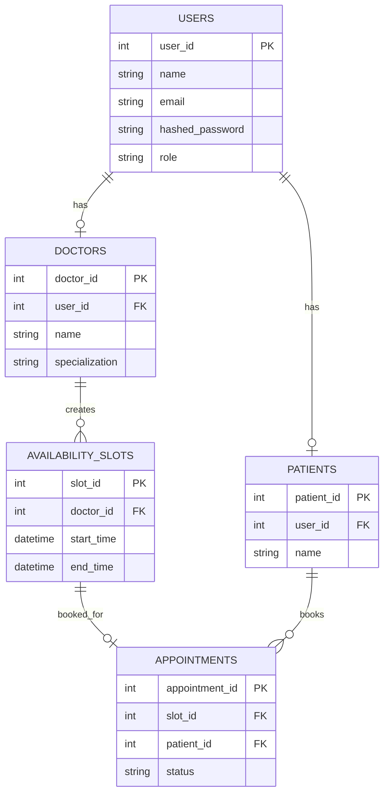

# ClinicCare - Entity Relationship Diagram

This diagram shows the relationship between the main database tables.

## Database Tables

1. **Users** – Stores login details and user roles.
2. **Doctors** – Stores doctor information.
3. **Patients** – Stores patient information.
4. **AvailabilitySlots** – Stores available appointment slots for doctors.
5. **Appointments** – Stores patient appointments.

## ER Diagram

